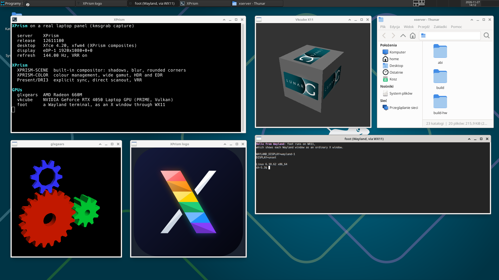
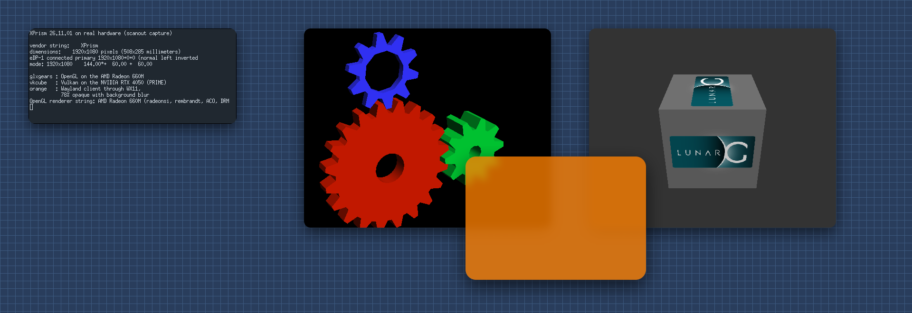

<p align="center">
  <picture>
    <source media="(prefers-color-scheme: dark)" srcset="doc/logo/logo-dark.svg">
    
  </picture>
</p>

<p align="center">
  <a href="https://github.com/XPrismOrg/xserver/actions/workflows/xprism.yml"></a>
  
</p>

XPrism is an X11 display server for Linux and the BSDs. It is a fork of
[XLibre](https://github.com/X11Libre/xserver), which continues the X.Org
Server.

The goal is to keep the X11 protocol and the software built on it, and to
add what X11 has always lacked: control over what each application is
allowed to do. A client on a classic X server can read the screen, log
keystrokes and send input to other applications. XPrism keeps those
abilities available, but the server decides which clients hold them, based
on a policy set by the user or the sandbox that launched the application.

XPrism runs as a regular X server with everything XLibre provides, and
adds the features below. [CHANGES-FROM-XORG.md](CHANGES-FROM-XORG.md)
lists every difference from the X.Org Server, including what was
removed.

The current version is **26.11.01**. Versions are `YY.MM.NN`, the NNth
release of that month, with `.PP` added for patch releases (`26.11.01.01`).

## Screenshots



*Xfce 4.20 on XPrism on a laptop panel, captured from the display
hardware (kmsgrab), not from the X server. glxgears renders on the AMD
iGPU that drives the panel, vkcube on the NVIDIA GPU through PRIME, and
foot is a Wayland application shown as an X window by
[WX11](wx11/README.md). xfwm4 manages the windows; XPrism composites
them.*



*The built-in compositor with a window manager that uses XPRISM-SCENE:
rounded corners and shadows on every window, and a 78% opaque Wayland
window (WX11) blurring what is behind it. No external compositor is
running.*

## Features

### Application isolation

Clients can be placed in namespaces (based on XLibre's Xnamespace). A
client in a namespace has its own clipboard and cannot see or reach the
windows, input or screen contents of other namespaces. See
[doc/Xnamespace.md](doc/Xnamespace.md).

### Launcher-assigned identity

A sandbox launcher can hand the server a socket that is bound to a
namespace and an application ID. Clients connecting through it are
placed there before their first request and cannot choose a different
identity. See [doc/Xnamespace-protocol.md](doc/Xnamespace-protocol.md)
and [utils/xns-listen](utils/xns-listen/README.md).

### Capabilities

XPrism defines twelve permissions, such as `capture.screen`,
`input.inject` and `clipboard.read`, each checked at the point where the
protocol performs the action. They are granted per namespace, can be
limited per launcher socket, and can be changed at runtime. They are
enforced by default; `-capmode audit` only logs what would be denied, and
a permission agent can ask the user. See [doc/capabilities.md](doc/capabilities.md).

[XPrism Control](https://github.com/XPrismOrg/xprism-control) shows and
changes namespaces, permissions, connected applications and display
settings while the server runs, in a window (`xprism-control-panel`) or a
terminal (`xprismctl`), and can answer the permission prompts.

### Server-side compositing

By default the server composites windows itself (`-compositor off`
disables it). ARGB windows and window opacity work without an external compositor, and
fullscreen windows bypass composition. The window manager can set
per-window opacity, transforms, rounded corners, shadows and background
blur through the XPRISM-SCENE extension.
External compositors such as picom still work. See
[doc/compositor.md](doc/compositor.md) and
[doc/xprism-scene-protocol.md](doc/xprism-scene-protocol.md).

### Colour management and HDR

Windows can declare their colour space
([XPRISM-COLOR](doc/xprism-color-protocol.md)); the compositor converts
them on the GPU and composes in linear light, for sRGB, wide-gamut and
HDR (PQ, HLG) monitors, one space per monitor. Laptop panels get
extended dynamic range (EDR): the backlight goes up for HDR content
while SDR content stays as it was. See [doc/color.md](doc/color.md).

### Modern display handling

Atomic modesetting is on by default, each output is composed at most
once per refresh, and variable refresh rate (FreeSync) works.

### Wayland applications

[WX11](wx11/README.md) runs Wayland applications as ordinary X windows,
managed by any X11 window manager: toplevels, popups, keyboard and
pointer, clipboard and primary selection, transparency. Each Wayland
application gets an X connection of its own, so XPrism's permissions
apply to it like to any X client, and sandboxed ones (via
`wp_security_context_v1`) land in a namespace.

### Platform abstraction layer

Operating-system specific code, such as peer credentials, process
information and sandbox detection, is kept behind one interface with a
backend per OS. See [doc/pal.md](doc/pal.md).

## Supported platforms

| Platform | Status |
|---|---|
| Linux | Full test suite in CI, tested on real hardware |
| FreeBSD, OpenBSD, NetBSD, DragonFly BSD | Built and tested in CI (the Python test suite on Xvfb) |

macOS and Windows, which XLibre supports, are not supported.

## Building

XPrism uses Meson and has the same dependencies as XLibre. The
[XLibre build instructions](https://github.com/X11Libre/xserver/wiki/Building-XLibre)
list the packages for common distributions.

```sh
git clone https://github.com/XPrismOrg/xserver.git
cd xserver
meson setup build -Dxvfb=true
ninja -C build
(cd wx11 && cargo build --release)   # WX11, optional
```

Run the test suite with:

```sh
meson test -C build
```

Commonly used options are `-Dxorg=true` (the hardware server),
`-Dxephyr=true` (a nested server) and `-Dxns_listen=enabled` (the launcher
helper). See [meson_options.txt](meson_options.txt) for the full list.

## Trying it out

Namespaces are configured in a file. This one defines a namespace called
`sandbox` whose clients may read the session clipboard:

```
auth MIT-MAGIC-COOKIE-1 11111111111111111111111111111111
namespace sandbox
  auth MIT-MAGIC-COOKIE-1 22222222222222222222222222222222
  grant clipboard.read
```

Start a virtual server with it:

```sh
./build/hw/vfb/Xvfb :5 -namespace ns.conf
```

Clients that authenticate with the second cookie run in `sandbox`. They can
paste from the session clipboard but cannot access anything else, and the
server log lists each capability they were refused. Add `-capmode audit`
to let them through and only log what they would need, or run
[xprism-permission-agent](utils/xprism-permission-agent/README.md) to be
asked. For running real
applications in a sandbox, see the bubblewrap example in
[utils/xns-listen](utils/xns-listen/README.md).

### A desktop session

XPrism's `Xorg` runs any X11 desktop. For example, Xfce on the second
virtual terminal:

```sh
xinit /usr/bin/startxfce4 -- /usr/local/bin/Xorg :1 vt2
```

The modesetting driver's XPrism options go in `xorg.conf`; all are off
by default:

```
Section "Device"
    Identifier "gpu"
    Driver     "modesetting"
    Option     "HDR"       "true"   # HDR monitors, from their EDID
    Option     "EDR"       "true"   # laptop panels: brighter HDR highlights
    Option     "WideGamut" "true"   # wide-gamut SDR monitors
EndSection
```

Each can also be changed while the server runs, per output:

```sh
xrandr --output eDP-1 --set EDR 1
xrandr --output DP-1 --set HDR 1
```

### Wayland applications

[WX11](wx11/README.md) shows Wayland applications as X windows:

```sh
wx11/target/release/wx11 &        # prints WAYLAND_DISPLAY=wayland-N
WAYLAND_DISPLAY=wayland-N foot     # the name it printed
```

### Colour and compositor effects in Xvfb

The virtual server has the same compositor, and can pretend to have an
HDR monitor or an EDR panel:

```sh
./build/hw/vfb/Xvfb :5 -colorspace bt2020,pq,1000   # an HDR monitor
./build/hw/vfb/Xvfb :5 -edr 4                       # a panel with 4x headroom
```

## Status

The current release is **26.11.01**, the first.

Every push is built and tested in CI. On Linux this is the full test
suite, run with the built-in compositor on and off: XPrism's own tests,
piglit, the X Test Suite, and display tests on a virtual KMS device. The
BSDs run the Python test suite. Every security check has a test, which
is shown to fail when the check is removed.

The display paths have been tried on real hardware: a desktop with an
AMD Renoir GPU and a FreeSync monitor, and a laptop with an AMD integrated GPU driving
the panel and an NVIDIA GPU rendering through PRIME. Mode changes, VRR,
VT switching, direct scanout of fullscreen windows, the compositor's
effects, Wayland applications through WX11, EDR with the panel's
backlight, and an Xfce desktop all worked; the results were checked
against the kernel's own display state. The test suite
also passes with glamor on both GPUs.

Not yet done or not yet tested:

- **Display:** HDR and wide-gamut output on a real monitor; scanout of
  16-bit floating point framebuffers; direct scanout of a window that
  covers only one of several monitors; GPU hotplug on real hardware.
- **WX11:** zero-copy buffers (dma-buf and Present), touch,
  subsurfaces, and drag and drop.
- **Platform layer:** session and device handling (the interface exists,
  without backends).

The protocols XPrism adds (X-NAMESPACE 1.2, XPRISM-SCENE 0.4,
XPRISM-COLOR 0.3) may still change before they reach version 1.0, apart
from X-NAMESPACE, whose changes keep compatibility.

## Documentation

- [doc/capabilities.md](doc/capabilities.md): the capability model
- [doc/Xnamespace.md](doc/Xnamespace.md): namespaces and their configuration
- [doc/Xnamespace-protocol.md](doc/Xnamespace-protocol.md): the X-NAMESPACE extension
- [doc/compositor.md](doc/compositor.md): the server-side compositor
- [doc/color.md](doc/color.md): colour management, wide gamut and HDR
- [doc/xprism-color-protocol.md](doc/xprism-color-protocol.md): the XPRISM-COLOR extension
- [doc/xprism-scene-protocol.md](doc/xprism-scene-protocol.md): the XPRISM-SCENE extension
- [doc/pal.md](doc/pal.md): the platform abstraction layer
- [wx11/README.md](wx11/README.md): WX11, Wayland applications on XPrism
- [XPrism Control](https://github.com/XPrismOrg/xprism-control): the control panel and `xprismctl`
- [CHANGES-FROM-XORG.md](CHANGES-FROM-XORG.md): every difference from the X.Org Server
- [CODE_OVERVIEW.md](CODE_OVERVIEW.md): layout of the source tree

## Contributing

Contributions are welcome. [CONTRIBUTING.md](CONTRIBUTING.md) explains how
to build, test and submit changes, and everyone taking part follows the
[Code of Conduct](CODE_OF_CONDUCT.md). In short:

- Every security check comes with a test, and the test must be shown to
  fail when the check is removed.
- No new OS-specific `#ifdef`s outside the platform abstraction layer. The
  `os-ifdefs` test enforces this.
- Changes to code inherited from XLibre are kept small and self-contained,
  so that merging from upstream stays practical and fixes can be offered
  back.

Questions go to [Discussions](https://github.com/orgs/XPrismOrg/discussions),
security issues to the [private reporting
form](https://github.com/XPrismOrg/xserver/security/advisories/new).

## License

XPrism is distributed under the MIT/X11 license, as are the X.Org Server
and XLibre. XPrism's own work is Copyright © 2026 Nexoniarz and XPrismOrg. See
[COPYING](COPYING) for the full terms and copyright notices.

X Window System is a trademark of The Open Group.
